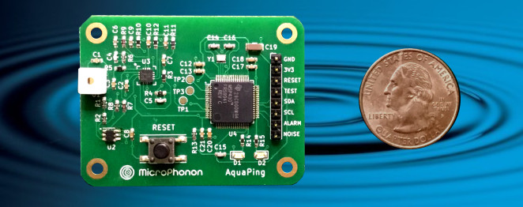

# acoustic-leak-detector

## Features
- Stand-off detection of small water leaks, even behind walls
- Designed for high sensitivity, reliability, and long battery life
- In-situ analysis – no audio streamed to cloud
- Smart Sensing
  - Nominal acoustic background acquired at startup
  - Statistical analysis distinguishes environmental noise
  - Impulse noise rejection
  - Eavesdropping impossible

- Two-way communication with host controller via I2C
  - Detailed sensor status available on demand
  - Sensing parameters highly configurable by host
  - Immediate notification with leak and noise alert interrupts

- Based on the Texas Instruments MSP430FR5994 MCU
  - FFT spectral analysis > 10x faster, more efficient than ARM-Cortex M0+
  - Direct Memory Access moves data without CPU intervention
  - Sensor operational voltage range: 1.8–3.6V

Specifications and complete details are in the comprehensive . An academic paper that describes the device design and performance is available at [arXiv.org](https://arxiv.org/abs/2511.00348). 

In this repository you will find:

- Design documentation, schematics, PCB layout, and firmware
- Stand-alone graphical user interface for a PC using [Arduino](https://store-usa.arduino.cc/products/arduino-nano-33-iot), [Raspberry Pi](https://www.raspberrypi.com/products/raspberry-pi-pico/), or [I2CDriver](https://i2cdriver.com/) as intermediary hardware for I2C communication
- Firmware for two-way text-based communication using the terminal
- Demonstration of sensor integration with Home Assistant using [ESPHome](https://devices.esphome.io/devices/aquaping/)  

A sensor board called AquaPing with pre-loaded firmware is available for purchase at [Mouser](https://www.mouser.com/ProductDetail/MicroPhonon/CS-AQUAPING-01?qs=IPgv5n7u5QZ96LnbcZcGBA%3D%3D) and  [Crowd Supply](https://www.crowdsupply.com/microphonon/aquaping). This is an open-hardware project.
